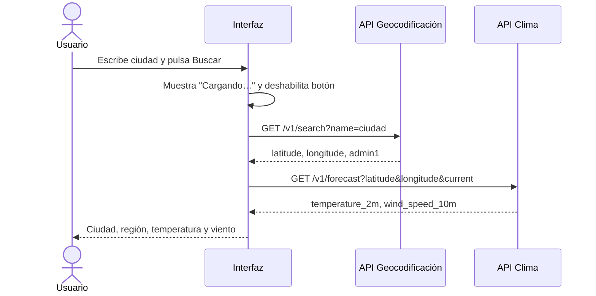

# Evaluación 03 – JavaScript (DOM, ES6+ y Fetch)


Proyecto de **Diseño de Interfaces de Programación Avanzado**: gestor de pedidos de CaféTec, refactorización moderna con módulos y widget de clima ClimaTec con Open-Meteo.

🔗 **GitHub Pages:** https://TU_USUARIO.github.io/evaluacion03-js/

## Tabla de contenidos
- [P1 – DOM, eventos y objetos](#p1--dom-eventos-y-objetos)
- [P2 – ES6+ y módulos](#p2--es6-y-módulos)
- [P3 – Fetch y async/await](#p3--fetch-y-asyncawait)
- [Diagrama de secuencia](#diagrama-de-secuencia-p3)
- [Bitácora de IA](#bitácora-de-ia)
- [Checklist](#checklist-de-entregables)
- [Conclusión](#conclusión)

## P1 – DOM, eventos y objetos

| Elemento | Evento | Acción |
| --- | --- | --- |
| `#form-pedido` | `submit` | `preventDefault()`, validar, crear pedido, `render()` |
| `#filtro` | `change` | `render()` con el estado elegido |
| `#lista-pedidos` | `click` (delegado) | Entregar o Eliminar según `data-accion` y `data-id`, luego `render()` |

```js
lista.addEventListener('click', (e) => {
  const btn = e.target.closest('button[data-id]');
  if (!btn) return;
  const id = Number(btn.dataset.id);
  // entregar o eliminar según btn.dataset.accion
  render();
});
```

**Delegación de eventos:** un solo listener en el `<ul>` funciona también para los pedidos creados después, usa menos memoria y evita añadir/quitar listeners en cada `render()`.

**Prueba de seguridad** con ``:

| Antes (`innerHTML`) | Después (`textContent`) |
| --- | --- |
|  |  |

Con `innerHTML` el navegador interpreta el texto como HTML y ejecuta el `onerror` (XSS). Con `textContent` se muestra como texto literal. **Decisión: `textContent`/`createElement`**, porque el producto lo escribe el usuario.

Capturas de funcionamiento: 

## P2 – ES6+ y módulos

**Cálculo manual:** Café 6×2 = 12; Croissant 4.5×0 = 0; Jugo 8×1 = 8 → subtotal 20 → ×1.18 = **S/ 23.60**.
El código antiguo devuelve **S/ 28.91** porque `cantidad || 1` trata el `0` como falso y lo vuelve 1 (suma 4.5 de más → 24.5×1.18). Con `??` solo se usa 1 si es `null`/`undefined`.

```js
const calcularTotal = (pedidos) =>
  pedidos.reduce((acc, { precio, cantidad }) => acc + precio * (cantidad ?? 1), 0) * (1 + IGV);
```

| Característica ES6+ | Dónde la usé | Por qué |
| --- | --- | --- |
| `const`/`let` | todo el código | evitar hoisting y reasignaciones de `var` |
| Funciones flecha | `calcularTotal`, `resumen` | sintaxis corta en callbacks |
| Template literals | `resumen`, `render` | evitar concatenar con `+` |
| Desestructuración con default | `resumen({ cantidad = 1 })` | valores por defecto sin `if` |
| `reduce()` | `calcularSubtotal` | acumular el total en una expresión |
| `?.` | `cliente?.nombre` | no falla si no hay cliente |
| `??` | `cantidad ?? 1` | respeta el `0` (corrige el error) |
| `class` + spread | `Pedido.marcarEntregado()` | actualizar sin mutar el arreglo |
| Módulos | `pedidos.js`, `ui.js`, `main.js` | separar lógica, DOM y arranque |

**Exports:** `export default` para la clase `Pedido` (lo principal del módulo); `export` nombrado para `IGV`, `calcularTotal`, `resumen` (varias utilidades que se importan por nombre).

**Error con `file://`:** 
Los módulos se cargan con CORS y `file://` no tiene origen válido, el navegador los bloquea. Se soluciona sirviendo por HTTP (Live Server).

## P3 – Fetch y async/await

| Endpoint | Parámetros que usa | Campos de la respuesta |
| --- | --- | --- |
| `geocoding-api.open-meteo.com/v1/search` | `name`, `count`, `language` | `results[0].name`, `admin1`, `latitude`, `longitude` |
| `api.open-meteo.com/v1/forecast` | `latitude`, `longitude`, `current` | `current.temperature_2m`, `current.wind_speed_10m` |

`fetch` **no** lanza error con 404/500 porque la promesa solo se rechaza si falla la red; una respuesta HTTP, aunque sea de error, es una respuesta válida. Por eso se verifica `response.ok`.

| Estado | Captura |
| --- | --- |
| Cargando |  |
| Éxito |  |
| Ciudad no encontrada |  |
| Sin conexión |  |

**Tiempos (Lima, Cusco, Arequipa)** – 

| Medición | Secuencial (ms) | Promise.all (ms) |
| --- | --- | --- |
| 1 | _completar_ | _completar_ |
| 2 | _completar_ | _completar_ |
| 3 | _completar_ | _completar_ |
| Promedio | _completar_ | _completar_ |

**Conclusión de tiempos:** _completar con tus números_ (las peticiones son independientes, en paralelo el tiempo ≈ el de la más lenta).

**`all` vs `allSettled`:** elegí `allSettled`, porque si una ciudad falla (p. ej. "Xyzabc") `Promise.all` rechaza todo y se pierden las que sí funcionaron.

## Diagrama de secuencia (P3)



## Bitácora de IA

| # | Pregunta | IA usada | ¿Qué propuso la IA? | Decisión | ¿Por qué? |
|---|----------|----------|---------------------|:--------:|-----------|
| 1 | P1 | Claude | `render()` con `createElement`/`textContent` y delegación en `#lista-pedidos` | Aceptó | Probé el payload `` y no se ejecutó; revisé que el total salga del arreglo |
| 2 | P1 | Claude | Rama con `innerHTML` para comparar | Corrigió | La dejé solo tras la constante `MODO_SEGURO`; con `false` salta el `alert` (captura "antes") |
| 3 | P2 | Claude | Refactor con `cantidad ?? 1` | Aceptó | Con el arreglo del enunciado la consola da 23.60 = cálculo manual |
| 4 | P2 | Claude | Poner `Pedido` en `export default` y utilidades con nombre | Corrigió | Lo revisé contra mis imports en `ui.js` y `main.js` y funcionó en Live Server |
| 5 | P3 | Claude | `buscarCiudad`/`obtenerClima` con `current=temperature_2m,wind_speed_10m` | Aceptó | Comparé cada parámetro y campo con open-meteo.com/en/docs |
| 6 | P3 | Claude | `Promise.allSettled` para la ciudad inválida | Aceptó | Probé Lima, Cusco, Xyzabc: dos OK y una con error |

## Checklist de entregables
- [x] P1: tabla de eventos, código en `p1-dom/`, capturas y prueba de seguridad
- [x] P2: cálculo manual, código antiguo y refactorizado en `p2-modulos/`
- [x] P3: tabla de endpoints, código en `p3-api/`, capturas de estados
- [x] Tabla de tiempos y justificación de `all` vs `allSettled`
- [x] README con badges, TOC, Mermaid, bitácora y conclusión
- [x] Mínimo 6 commits y GitHub Pages publicado

## Conclusión

Las decisiones técnicas importantes las tomé yo y las comprobé con pruebas. Elegí delegación de eventos con un solo listener en la lista porque los botones se vuelven a crear en cada `render()`. Usé `textContent` en lugar de `innerHTML` después de ver que el payload `` ejecutaba un `alert` con `innerHTML`. Cambié `||` por `??` porque la cantidad 0 de un pedido cancelado se convertía en 1 y el total salía S/ 28.91 en vez de S/ 23.60. Para varias ciudades preferí `Promise.allSettled`, ya que con `Promise.all` una ciudad inválida arruina todo el resultado. Entre los errores de la IA que debo vigilar están usar `innerHTML` con datos del usuario y mantener `||`, y los detecté con la consola y con cálculos manuales. Verifiqué los parámetros de Open-Meteo con su documentación oficial y no con la respuesta de la IA. La IA me ayudó en estructura repetitiva, borradores de código y en ordenar módulos, pero no en decidir seguridad, en validar resultados ni en explicar por qué algo falla; eso lo tuve que probar y entender yo para poder sustentarlo sin ayuda.
